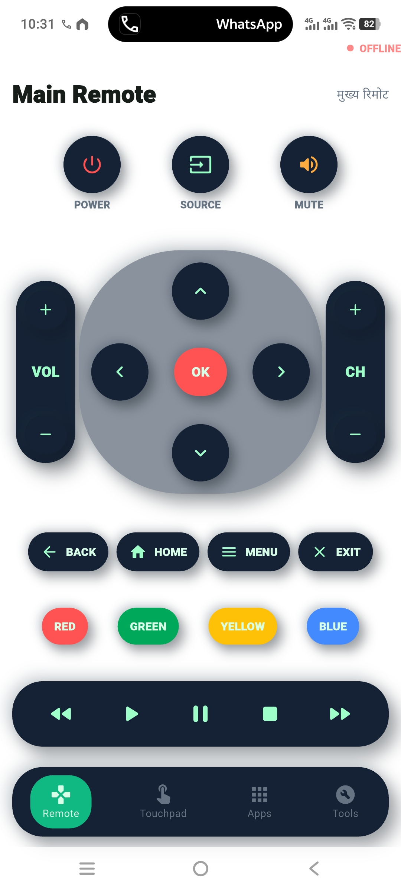
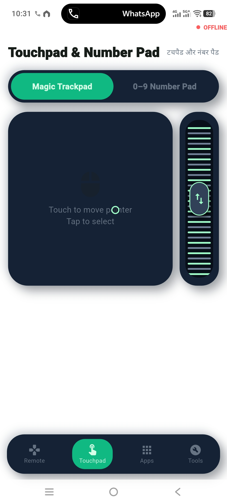
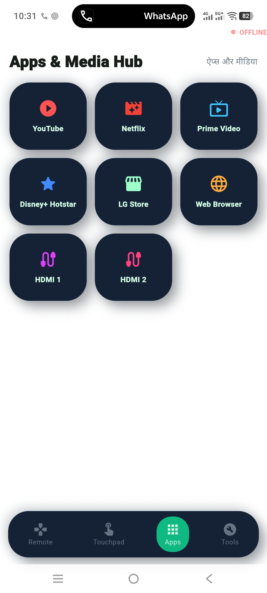

# LG webOS Smart TV Remote

A Flutter Android remote control app for LG webOS Smart TVs, including the LG 41UP7550 series.

## Screenshots

| Main Remote | Touchpad | Apps Hub |
|---|---|---|
|  |  |  |

## Features

- Automatic LG TV discovery on the local Wi-Fi network
- LG webOS SSAP WebSocket pairing and persistent client key
- D-pad, OK, volume, channel, power, mute and media controls
- Touchpad pointer control with scroll wheel and haptic feedback
- YouTube, Netflix, Prime Video, LG Store and HDMI launchers
- Toast messages and remote keyboard input
- Claymorphism UI with responsive four-tab navigation

## Build

```bash
flutter pub get
flutter build apk --release
```

The release APK is generated at `build/app/outputs/flutter-apk/app-release.apk`.
